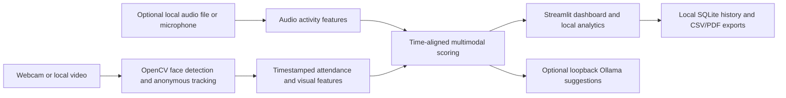

# EduSense AI — Multimodel Attendance

EduSense AI is a local classroom video analysis demo. It detects faces, assigns anonymous session-only track labels, estimates observed presence, combines visual signals with optional audio activity, and produces session summaries. It is intended to help a teacher review patterns; it does not measure learning or replace teacher judgment.

**Repository:** [AryanGpt59/Multimodel_Attendance](https://github.com/AryanGpt59/Multimodel_Attendance), forked from [AGENTBATAK/Multimodel_Attendance](https://github.com/AGENTBATAK/Multimodel_Attendance).

## What is implemented

| Feature | Current implementation |
|---|---|
| Face detection | OpenCV Haar cascades; the detector's placeholder confidence is not a calibrated probability. An optional local MediaPipe Face Landmarker model provides approximate head-pose signals. |
| Identity recognition | Not implemented. Track labels are anonymous and only last for one run. |
| Attendance | Anonymous centroid tracks accumulate short, timestamped observation intervals. A configurable observed-time threshold (3 seconds by default) confirms a profile; long detection gaps do not count toward presence. This is not roster identity. |
| Audio | Local one-second audio-file analysis in the dashboard; optional microphone RMS monitoring in the command-line runner. No transcription is performed. |
| Engagement | Heuristic combination of estimated visual focus, movement, and measured audio activity. A visual detection is required for an engagement score; audio alone is reported as activity. Missing audio is excluded from the score. |
| Teaching suggestions | Optional local Ollama request using aggregate metrics. The dashboard is opt-in; the command-line runner requests suggestions when its trigger rule fires. |
| Session history | Local SQLite database, up to 50 sessions. Derived metrics and anonymous track records are saved; raw video and audio are not saved in history. |
| Reports | Separate dashboard metrics and attendance CSV downloads, plus PDF; the command-line runner writes metrics and attendance CSV files, including observed duration and confirmation threshold. |

This repository is a Python and Streamlit application. It does not currently contain the proposed FastAPI/React/WebSocket backend, DeepFace identity recognition, DeepSORT, Groq integration, student roster matching, or teacher accounts. Those are future work, not implemented features.

## Architecture



The diagram describes the current Python application. Audio is optional and never transcribed. Ollama receives aggregate counts and numeric metrics only.

## Requirements

- Python 3.11 or later
- A webcam or a supported local video file
- Optional audio file for the dashboard, or a microphone for `app.py`
- Optional local Ollama installation and model for teaching suggestions
- Optional MediaPipe `.task` face-landmarker model for the dashboard

## Install

Create and activate a virtual environment, then install the pinned dependencies.

```powershell
python -m venv .venv
.\.venv\Scripts\Activate.ps1
python -m pip install --upgrade pip
python -m pip install -r requirements.txt
```

## Run

Start the dashboard:

```powershell
python -m streamlit run dashboard.py
```

The dashboard can analyze a webcam or an uploaded MP4, AVI, MOV, or MKV video. It analyzes a bounded number of frames (300 by default; configurable up to 1,200), so it is a demonstration workflow rather than continuous full-class monitoring. Optional audio files are WAV, MP3, FLAC, or OGG. Audio starts at the beginning of the webcam run or video timeline; it is not extracted from the video. If no measured audio is available, the score uses visual signals only; if there are no visual detections, no engagement score is reported.

In **Optional inputs and analysis settings**, set the attendance confirmation duration. A profile is confirmed after that amount of observed video time. The tracker adds an observation interval only when the gap between detections is at most 1 second; tracks are retired after 1.5 seconds without a matching detection. These gap rules are in `config.py`.

The command-line runner uses webcam index `0` and attempts to read microphone activity:

```powershell
python app.py --source 0
```

Set a different observed-time threshold when needed:

```powershell
python app.py --source 0 --presence-seconds 5
```

For a prerecorded video, the command-line runner does not extract embedded audio and will not open the microphone. With a webcam source, it attempts microphone activity unless `--no-audio` is set.

```powershell
python app.py --source .\classroom-demo.mp4 --max-frames 900 --no-display
```

The command-line runner writes `session_metrics.csv` and `attendance_session_metrics.csv` in the current directory by default. Set `--log-csv` to choose the metrics filename.

## Local Ollama suggestions

Suggestions are optional and use `http://127.0.0.1:11434/api/generate`. The endpoint and model tag are defined in `config.py`; the default model tag is `phi3:mini`. Install and start Ollama locally, then pull the configured model before enabling suggestions. Only aggregate counts and numeric session metrics are sent to that loopback service. The application does not call a cloud AI provider.

## Session history and exports

- The dashboard can save completed sessions locally; history is limited to the 50 most recent sessions.
- On Windows, the database is `%LOCALAPPDATA%\MultimodelAttendance\session_history.sqlite3`. On Linux/macOS, it is `$XDG_DATA_HOME/MultimodelAttendance/session_history.sqlite3`, defaulting to `~/.local/share`.
- Saved records contain derived timeline metrics and anonymous track labels with observed timestamps. They do not contain raw video frames or raw audio.
- Uploaded media is temporarily copied to the operating system's temporary directory for local processing, then deleted when the analysis action finishes. A forced process termination may leave a temporary file behind.
- Use **Clear saved history** on the Analytics page to delete saved session records. CSV and PDF exports are created only when downloaded by the user.

## Privacy and interpretation

Video and audio processing runs locally. Audio features are simple signal measurements and a speech-like activity heuristic; speech content is neither recognized nor recorded. The visual focus estimate is approximate head orientation, not attention or emotion recognition. Stillness, silence, and head direction do not establish whether someone is learning. Results should be reviewed in context and must not be used as an automatic high-stakes decision about a student.

Attendance is based on anonymous centroid tracks and a configurable threshold of observed video time (3 seconds by default). It is not linked to a student roster, and track switches or short-lived detections can affect counts. The dashboard's optional expected class size supports a rough percentage only; it does not verify which students are present.

## Validation

Run the behavioral tests with:

```powershell
python -m unittest discover -s tests -v
```

The tests cover time-based attendance across different frame rates, long detection gaps, core analytics, audio-window alignment, local storage, PDF generation, and the local Ollama response contract. They do not validate detection quality or fairness in real classrooms. Check dependency consistency with `python -m pip check`.

## Project layout

- `app.py` — command-line runner and shared per-frame helpers
- `dashboard.py` — Streamlit dashboard and local media workflow
- `analytics_engine.py` — face detection/tracking, audio features, scoring, and summaries
- `session_store.py` — local SQLite history
- `llm_agent.py` — loopback-only Ollama client and response validation
- `reporting.py` — in-memory PDF report generation
- `config.py` — thresholds, model tag, and local dashboard settings
- `tests/test_core.py` — behavioral tests

## Not implemented and future work

Reliable roster identity matching, calibrated signal validation, richer error states, broader automated workflow tests, and a deployment/demo strategy remain future work. Teacher performance profiles, emotion recognition, and student leaderboards are intentionally not presented as real features. No hosted demo is published. Any hosted version would need a separate review of camera access, data flows, access control, retention, and consent.
